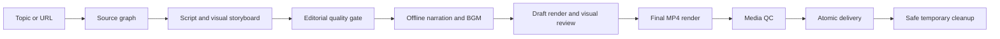

# Codex Local Video Studio

Turn a topic, post, article, or storyboard into an evidence-backed motion-graphics MP4—researched, narrated, scored, rendered, checked, and cleaned up by Codex on Windows or Linux.

[](https://github.com/Wang-Ruibin/codex-local-video-studio/actions/workflows/validate.yml)
[](LICENSE)

[简体中文](README.zh-CN.md) · [Plugin manifest](plugins/codex-local-video-studio/.codex-plugin/plugin.json) · [Science explainer standard](plugins/codex-local-video-studio/skills/local-video-studio/references/science-explainer-quality.md)

## Quick start

### Prerequisites

- A current Codex CLI or app build with `codex plugin` support.
- Python 3.10 or later.
- Windows 10/11 or a modern Linux distribution.
- Internet access for source research and the first Python dependency installation. Video rendering itself is local.
- An offline speech backend:
  - Windows: an installed SAPI voice.
  - Linux: `espeak-ng`/`espeak`, or Piper with a separately selected voice model.

### Install from GitHub

```shell
codex plugin marketplace add Wang-Ruibin/codex-local-video-studio
codex plugin add codex-local-video-studio@codex-local-video-studio
```

Start a new Codex thread after installation so the skill is loaded.

### Choose the output directory

If unset, output defaults to `~/Videos/local-video-studio`.

Windows PowerShell:

```powershell
$env:LOCAL_VIDEO_STUDIO_ROOT = "D:\video"
```

Linux:

```bash
export LOCAL_VIDEO_STUDIO_ROOT="$HOME/Videos/local-video-studio"
```

### Ask for a video

```text
Turn this article into a polished 60-second vertical science explainer.
```

You can also provide a social-post URL, a topic, local assets, or an existing storyboard. The normal handoff is one MP4; temporary storyboards, narration, BGM, subtitles, contact sheets, and QC reports are removed after successful delivery.

## What it does

- Follows links and essential citations beyond the seed post or article.
- Maps claims to sources and distinguishes evidence from interpretation.
- Uses a narrative spine: hook, question, mechanism, evidence, implication, recap.
- Produces code-native diagrams, comparisons, charts, scales, timelines, and recap views.
- Creates phrase-level captions instead of leaving full narration on screen.
- Generates restrained procedural BGM and ducks it under narration.
- Uses Windows SAPI, Linux eSpeak, optional Linux Piper, or supplied scene audio.
- Renders H.264/AAC MP4 through a locally cached FFmpeg binary.
- Blocks delivery when the storyboard quality score is below 80 or media QC fails.
- Deletes only marker-protected temporary work directories after atomic delivery.

## Workflow



## Platform support

| Capability | Windows | Linux |
| --- | --- | --- |
| Motion-graphics renderer | Yes | Yes |
| Bundled FFmpeg through `imageio-ffmpeg` | Yes | Yes |
| Offline baseline narration | SAPI | eSpeak |
| Optional neural narration | User-supplied audio | Piper model |
| Procedural BGM and ducking | Yes | Yes |
| Editorial and media QC | Yes | Yes |
| Safe automatic cleanup | Yes | Yes |

See the [platform setup reference](plugins/codex-local-video-studio/skills/local-video-studio/references/platform-setup.md) for backend selection and environment variables.

## Configuration

| Variable | Purpose | Default |
| --- | --- | --- |
| `LOCAL_VIDEO_STUDIO_ROOT` | Final videos and marker-protected temporary jobs | `~/Videos/local-video-studio` |
| `LOCAL_VIDEO_STUDIO_CACHE` | Shared virtual environment and FFmpeg cache | OS-specific user cache |
| `PIPER_MODEL` | Absolute path to an optional Linux Piper voice model | Unset |

The storyboard schema also supports platform-specific narration fields such as `voice_windows`, `voice_linux`, `rate`, and `rate_wpm`.

## Quality model

The workflow follows evidence-backed multimedia design principles: remove extraneous material, signal important relationships, synchronize graphics with narration, keep labels near what they describe, avoid verbatim narration on screen, and segment mechanisms into causal steps.

Before delivery, `review_storyboard.py` checks narrative roles, visual diversity, text density, source completeness, chart data, and placeholders. A draft contact sheet then receives a visual review before the final render.

## Security and privacy

- No video-generation website, video-editor account, or API key is required.
- Source research may access public web pages requested by the workflow.
- Original user files are copied, never moved or deleted.
- Recursive cleanup requires a valid work-directory marker, matching storyboard hash, passing editorial report, passing media report, and a final destination outside the temporary directory.
- Secrets, cookies, tokens, and private source material must not be written to storyboards or provenance files.
- Review the license of any user-selected Piper model or third-party media before publication.

Report sensitive security issues through a private GitHub security advisory. Use public issues for non-sensitive bugs and feature requests.

## Limitations

- The plugin creates code-driven motion graphics, not photorealistic text-to-video, avatar lip-sync, or fabricated live action.
- SAPI and eSpeak are reliable offline baselines but may not sound like studio narration. Supply recorded audio or a suitably licensed Piper model when voice quality is critical.
- Local 1080p/60fps rendering can be CPU-intensive.
- Procedural BGM is intentionally restrained and is not a replacement for a commissioned score.
- Generated concept art may support atmosphere or spatial intuition, but it must not be treated as evidence.

## Troubleshooting

### The plugin does not appear

Confirm the marketplace and plugin are installed:

```shell
codex plugin marketplace list
codex plugin list
```

Then start a new Codex thread.

### Linux narration is unavailable

Install eSpeak or configure Piper:

```bash
sudo apt-get install espeak-ng
export PIPER_MODEL="$HOME/.local/share/piper/voice.onnx"
```

### Windows SAPI fails only inside Codex

The sandbox may block speech COM access. Allow a narrowly scoped rerun of the render command; do not reinstall voices based only on a sandbox access error.

### Rendering stops before delivery

Inspect the retained temporary job. The workflow intentionally keeps it when editorial review, rendering, visual inspection, or media QC fails. Cleanup happens only after a valid final MP4 is atomically delivered.

## Contributing

Issues and focused pull requests are welcome. Keep Windows and Linux behavior aligned, update English and Simplified Chinese documentation together, and run:

```shell
python scripts/validate_repository.py
python -m unittest discover -s tests -v
```

Do not commit rendered videos, narration files, local voice models, virtual environments, credentials, or temporary job directories.

## License

MIT © 2026 Wang-Ruibin. See [LICENSE](LICENSE).

---

<div align="center">

If this little studio turns your ideas into videos, a ⭐ Star would keep its lights on. 🎬✨

[](https://star-history.com/#Wang-Ruibin/codex-local-video-studio&Date)

</div>
