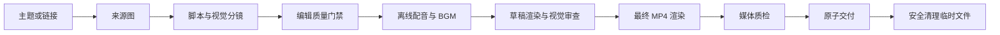

# Codex Local Video Studio

把主题、推文、文章或分镜转成有来源依据的动效 MP4：由 Codex 在 Windows 或 Linux 上完成检索、配音、评分、渲染、质检和安全清理。

[](https://github.com/Wang-Ruibin/codex-local-video-studio/actions/workflows/validate.yml)
[](LICENSE)

[English](README.md) · [插件清单](plugins/codex-local-video-studio/.codex-plugin/plugin.json) · [科普视频质量规范](plugins/codex-local-video-studio/skills/local-video-studio/references/science-explainer-quality.md)

## 快速开始

### 前置条件

- 当前版本的 Codex CLI 或应用，并支持 `codex plugin`。
- Python 3.10 或更高版本。
- Windows 10/11 或现代 Linux 发行版。
- 检索资料和首次安装 Python 依赖时需要网络；视频渲染本身在本地完成。
- 一个离线语音后端：
  - Windows：已安装的 SAPI 语音。
  - Linux：`espeak-ng`/`espeak`，或 Piper 加自行选择的语音模型。

### 从 GitHub 安装

```shell
codex plugin marketplace add Wang-Ruibin/codex-local-video-studio
codex plugin add codex-local-video-studio@codex-local-video-studio
```

安装后新建一个 Codex 对话，使 skill 被重新加载。

### 选择输出目录

未设置时默认使用 `~/Videos/local-video-studio`。

Windows PowerShell：

```powershell
$env:LOCAL_VIDEO_STUDIO_ROOT = "D:\video"
```

Linux：

```bash
export LOCAL_VIDEO_STUDIO_ROOT="$HOME/Videos/local-video-studio"
```

### 直接要求制作视频

```text
把这篇文章制作成一条精致的 60 秒竖版科普视频。
```

也可以提供社交媒体链接、主题、本地素材或已有分镜。默认只交付一个 MP4；成功交付后会删除临时分镜、旁白、BGM、字幕、抽帧图和质检报告。

## 核心能力

- 从初始推文或文章继续访问关键外链和引用。
- 建立主张与来源映射，区分证据和解释。
- 使用“钩子、问题、机制、证据、意义、回顾”的叙事骨架。
- 生成代码原生的机制图、对比图、数据图、尺度图、时间线和总结画面。
- 使用短语级字幕，不把整段旁白常驻在屏幕上。
- 自动生成克制的程序化 BGM，并在人声出现时自动闪避。
- 支持 Windows SAPI、Linux eSpeak、可选 Linux Piper 或用户提供的分场音频。
- 使用本地缓存的 FFmpeg 渲染 H.264/AAC MP4。
- 分镜评分低于 80 或媒体质检失败时禁止交付。
- 原子交付成功后，只删除带专用标记的临时工作目录。

## 工作流程



## 平台支持

| 能力 | Windows | Linux |
| --- | --- | --- |
| 动效渲染器 | 支持 | 支持 |
| 通过 `imageio-ffmpeg` 提供 FFmpeg | 支持 | 支持 |
| 离线基础配音 | SAPI | eSpeak |
| 可选神经配音 | 用户提供音频 | Piper 模型 |
| 程序化 BGM 与人声闪避 | 支持 | 支持 |
| 编辑与媒体质检 | 支持 | 支持 |
| 安全自动清理 | 支持 | 支持 |

语音后端选择和环境变量请参阅[平台配置说明](plugins/codex-local-video-studio/skills/local-video-studio/references/platform-setup.md)。

## 配置

| 变量 | 用途 | 默认值 |
| --- | --- | --- |
| `LOCAL_VIDEO_STUDIO_ROOT` | 最终视频和带标记的临时任务 | `~/Videos/local-video-studio` |
| `LOCAL_VIDEO_STUDIO_CACHE` | 共享虚拟环境和 FFmpeg 缓存 | 操作系统用户缓存目录 |
| `PIPER_MODEL` | 可选 Linux Piper 模型的绝对路径 | 未设置 |

分镜还支持 `voice_windows`、`voice_linux`、`rate` 和 `rate_wpm` 等平台语音字段。

## 质量模型

工作流遵循有研究依据的多媒体设计原则：删除无关信息、提示关键关系、让图形与旁白同步、把标签放在对应对象旁边、避免屏幕文字复述旁白，并把复杂机制拆成因果步骤。

交付前，`review_storyboard.py` 会检查叙事角色、视觉多样性、文字密度、来源完整性、图表数据和占位内容。随后必须检查草稿抽帧，再渲染最终成片。

## 安全与隐私

- 不需要视频生成网站、视频编辑器账号或 API key。
- 检索阶段可能访问工作流所需的公开网页。
- 用户原始文件只会被复制，不会被移动或删除。
- 递归清理必须同时满足：工作目录标记有效、分镜哈希匹配、编辑报告通过、媒体报告通过，且成品目标在临时目录之外。
- 不得把密码、Cookie、令牌或私密原始资料写进分镜和来源记录。
- 发布前应检查用户选择的 Piper 模型和第三方媒体许可证。

敏感安全问题请通过 GitHub 私密安全公告报告；普通缺陷和功能建议使用公开 Issue。

## 限制

- 插件制作的是代码动效视频，不是写实文生视频、数字人口型或虚构真人画面。
- SAPI 和 eSpeak 是可靠的离线基线，但未必达到棚录音质；声音质量关键时请提供录音或许可证合适的 Piper 模型。
- 本地 1080p/60fps 渲染可能占用较多 CPU。
- 程序化 BGM 刻意保持克制，不能替代定制配乐。
- 生成式概念图可以辅助气氛或空间理解，但不能作为事实证据。

## 故障排查

### 插件没有出现

确认 marketplace 和插件已经安装：

```shell
codex plugin marketplace list
codex plugin list
```

随后新建一个 Codex 对话。

### Linux 无法配音

安装 eSpeak 或配置 Piper：

```bash
sudo apt-get install espeak-ng
export PIPER_MODEL="$HOME/.local/share/piper/voice.onnx"
```

### Windows SAPI 只在 Codex 中失败

沙箱可能阻止语音 COM 访问。仅对渲染命令进行窄范围授权重试；不要仅凭沙箱访问错误重装语音。

### 渲染在交付前停止

检查保留的临时任务。编辑审查、渲染、视觉检查或媒体质检失败时，工作流会有意保留现场；只有有效 MP4 原子交付后才会清理。

## 贡献

欢迎提交 Issue 和范围清晰的 Pull Request。请保持 Windows/Linux 行为一致，在同一提交中同步更新英文和简体中文文档，并运行：

```shell
python scripts/validate_repository.py
python -m unittest discover -s tests -v
```

不要提交渲染视频、旁白文件、本地语音模型、虚拟环境、凭据或临时任务目录。

## 许可证

MIT © 2026 Wang-Ruibin。参见 [LICENSE](LICENSE)。

---

<div align="center">

如果这间小影棚把你的想法做成了视频，送它一颗 ⭐ Star，让影棚的灯一直亮着吧。🎬✨

[](https://star-history.com/#Wang-Ruibin/codex-local-video-studio&Date)

</div>
